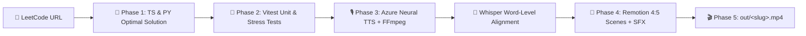

<div align="center">

# ▲ Visual LeetCode (`visual-leet`)

**Turn any LeetCode URL into optimal, tested code and a viral 4:5 vertical algorithm explainer video — in a single prompt.**

[](https://www.remotion.dev/)
[](https://www.typescriptlang.org/)
[](https://www.python.org/)
[](https://vitest.dev/)
[](./LICENSE)

<p align="center">
  <b>ByteByteGo Sketch Diagrams</b> · <b>Antigravity 2.0 Motion Physics</b> · <b>Neural TTS Voiceover</b> · <b>Whisper Micro-Frame Word Captions</b>
</p>

</div>

---

## ✨ What is `visual-leet`?

**`visual-leet`** is an agentic skill and **Remotion** motion-graphics engine designed for short-form technical content (TikTok, YouTube Shorts, Instagram Reels, Facebook Reels).

Drop any LeetCode link into your AI coding assistant:

```text
/visual-leet https://leetcode.com/problems/maximal-square/description/
```

And the workspace automatically executes an end-to-end **5-phase production pipeline**:

1. 🧠 **Optimal Algorithm Implementation** — Writes clean, idiomatic, complexity-optimal solutions in both **TypeScript** (`solution.ts`) and **Python** (`solution.py`) with explicit invariant documentation.
2. 🧪 **Exhaustive Unit Testing** — Generates and runs a comprehensive **Vitest** test suite (`solution.test.ts`) covering official examples, edge cases, monotonic/degenerate inputs, and large-scale $O(N)$ / $O(M \times N)$ stress tests.
3. 🎙️ **Punchy Neural Voiceover & Micro-Frame Captions** — Synthesizes natural Vietnamese male tech narration (`vi-VN-NamMinhNeural` via `edge-tts`), accelerates pacing with `ffmpeg` (`atempo=1.25..1.35`), and extracts exact word-level timestamps using **OpenAI Whisper** (`word_timestamps=True`).
4. 🎨 **4:5 Vertical Motion Graphics (`1080 × 1350`)** — Builds a dynamically sized Remotion composition with 5 structured scenes, interactive step-by-step pointer/grid simulations, synchronized sound effects (`push`, `pop`, `ding`, `success`), and anti-theft watermarking.
5. 🎬 **Automated H.264 + AAC Rendering** — Renders the final broadcast-ready `.mp4` directly to `out/<problem-slug>.mp4`.

---

## 🏗️ End-to-End Architecture



---

## 🎨 Visual & Motion Design System

Every video generated by `visual-leet` adheres to strict visual storytelling rules engineered for maximum viewer retention:

### 1. ⚡ "Whip-In — Hard Brake — Plateau" Physics
Cards and diagrams never fade in lazily. Every visual element enters with high initial velocity (`whipIn` / `whipInX`), overshoots slightly via tuned spring physics (`damping: 11, stiffness: 240, mass: 0.5`), and settles onto a rock-solid plateau so viewers can read code and state transitions effortlessly.

### 2. 🎯 Zero Static Pages
Elements never appear all at once. Within every scene, each spoken clause triggers the entrance or state transition of its corresponding card, pointer, or formula at the exact micro-frame.

### 3. 💥 Viral Single-Word Pop-Up Captions (`cc.mp4` Standard)
- **Strictly MAX 1 Word on Screen**: Displays one ultra-bold uppercase word at a time (`80px–84px` **Montserrat Black / Impact**), synchronized to the speaker's voice via Whisper word timestamps.
- **High-Contrast Color Coding**: Electric Yellow (`#FFE600`) for core concepts, Emerald Green (`#4ADE80`) for optimal steps, Cyan (`#38BDF8`) for pointers/directions, Coral Red (`#EF4444`) for bottlenecks/eliminations, and Purple (`#C084FC`) for complexity terms.
- **3D Neo-Brutal Stroke**: `4.5px` solid black outline (`paint-order: stroke fill`), stacked 3D drop shadows, spring scale bounce (`0.65 → 1.14 → 1.0`), and alternating kinetic tilt (`±2.5°`).

### 4. 📐 ByteByteGo Sketch Aesthetics & Step-by-Step Simulation
- **5-Scene Narrative Arc** with **Dynamic Duration** (automatically scaled to the real `ffprobe` audio length and number of algorithm steps — never hardcoded):
  1. **Intro Scene**: Visualizes the raw input structure, rotation/bottleneck challenge, and target goal.
  2. **Intuition Scene**: Contrasts the naive brute-force approach against the optimal breakthrough insight.
  3. **Core Rules Scene**: Breaks down the algorithm's invariants into 3 actionable rules.
  4. **Explicit Step-by-Step Simulation Scene**: Features an interactive **Progress Stepper Bar**, live pointer/cell badges (`L`, `MID`, `R`, `TOP`, `LEFT`, `DIAG`), red strikethroughs (`✕`), code trace callouts, and synchronized SFX.
  5. **Summary & Interview Tip Scene**: Highlights production-ready code, Time/Space complexity cards, and follow-up interview variations.
- **First-Frame Video Thumbnail (`frame === 0`)**: The very first frame of every video renders a dedicated, full-opacity poster thumbnail (`<ThumbnailFrame />`) featuring the `"▲ Leetcode Mô Phỏng"` channel badge, the official English LeetCode problem code (`LEETCODE #<ID>`), difficulty badge, and official English problem title.
- **Built-in Brand Header & Anti-Theft Watermark**: Every scene carries the `"▲ Leetcode Mô Phỏng"` header badge (with the English problem title and code) and a subtle corner watermark.

---

## 🛠️ Prerequisites

Make sure the following tools are installed on your machine:

- **Node.js** `>= 18` & **npm**
- **Python** `>= 3.10`
- **FFmpeg** & **FFprobe** (`brew install ffmpeg` on macOS)
- **Python packages** for TTS and Whisper alignment:
  ```bash
  pip install edge-tts openai-whisper
  ```

---

## 🚀 Quick Start

### 1. Clone & Install Dependencies

```bash
git clone https://github.com/nvkhuy/visual-leet.git
cd visual-leet
npm install
```

### 2. Generate a Video with `/visual-leet`

In your AI coding agent (Antigravity / Cursor / Claude Code), run:

```text
/visual-leet https://leetcode.com/problems/search-in-rotated-sorted-array/description/
```

Or ask the agent in natural language:

```text
Use /visual-leet to solve and generate a video for https://leetcode.com/problems/maximal-square/description/
```

### 3. Useful Commands

```bash
# Run all Vitest unit & stress tests
npm test

# Launch interactive Remotion Studio at http://localhost:3000
npm start

# Render a specific composition to MP4
npx remotion render src/index.ts <CompositionId> out/<slug>.mp4
```

---

## 📁 Repository Structure

```text
visual-leet/
├── .agents/
│   └── skills/
│       └── visual-leet/
│           └── SKILL.md                  # 5-phase agent skill instructions
├── AGENTS.md                             # Workspace rules & motion graphics spec
├── public/
│   └── audio/
│       ├── sfx_push.mp3                  # Step transition / pointer advance SFX
│       ├── sfx_pop.mp3                   # Candidate elimination / bottleneck SFX
│       ├── sfx_ding.mp3                  # Match found / state upgrade SFX
│       └── sfx_success.mp3               # Algorithm completion SFX
├── src/
│   ├── index.ts                          # Remotion entrypoint
│   ├── Root.tsx                          # Remotion composition registry
│   ├── shared/                           # Reusable motion & sketch primitives
│   │   ├── motion/
│   │   │   ├── motionUtils.ts            # whipIn & whipInX spring helpers
│   │   │   ├── PopupCaption.tsx          # Single-word viral kinetic captions
│   │   │   ├── ThumbnailFrame.tsx        # Frame-0 video thumbnail ("Leetcode Mô Phỏng" + English title/code)
│   │   │   └── TypographyHeader.tsx      # "Leetcode Mô Phỏng" header component
│   │   └── sketch/
│   │       └── SketchBackground.tsx      # Dot-grid canvas + anti-theft watermark
│   └── problems/                         # Generated per-problem solutions & videos
│       └── <problem-slug>/
│           ├── solution.ts               # Optimal TypeScript solution
│           ├── solution.py               # Optimal Python solution
│           ├── solution.test.ts          # Exhaustive Vitest unit test suite
│           └── video/                    # 5 Remotion scenes + Whisper captionsData.json
├── package.json
├── remotion.config.ts
└── tsconfig.json
```

---

## 📄 License

Distributed under the **MIT License**. See [`LICENSE`](./LICENSE) for more information.
